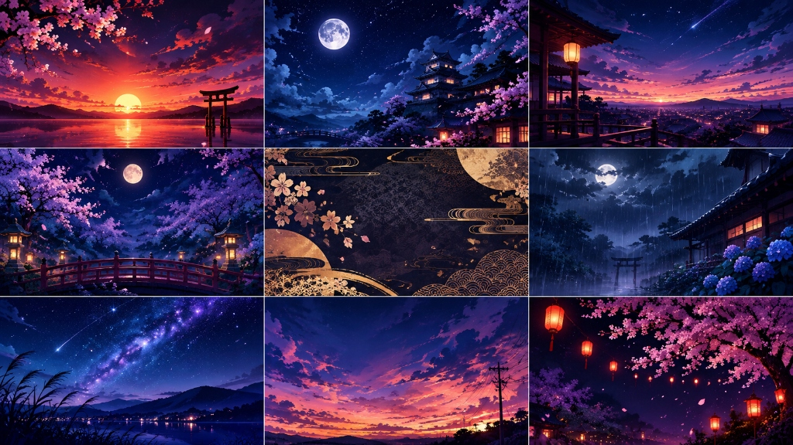

# Sunset Fall (夕暮れの落下) 🌅🌸

夕暮れ・夜桜・トワイライトの美しい和風世界観を舞台にした、ブラウザで遊べるスピード避けアクションゲームです。  
Python (Flask) と SQLite によるオンラインハイスコアランキング機能を搭載しています。



## ✨ 特徴
- **全9幕のエモい背景ステージ**: プレイするごとに「茜空の鳥居」「月下の桜城」「宵闇の楼閣」など、美しい背景が自動で切り替わります（手動選択も可能）。
- **落ちてくる夕日の破片を回避**: 時間が経つほど落下スピードが増加！スリリングなスピード感を体感できます。
- **一番星ボーナス**: 降ってくるスターを拾うとスコア +100点＆キラキラ演出。
- **舞い散る桜の花びら**: 背景に合わせて桜の花びらがゆらゆらと舞い落ちるパーティクル演出。
- **内蔵シンセサイザーBGM**: Web Audio API による完全内蔵のアンビエント／シンセウェーブ音楽＆効果音。
- **オンラインランキング**: SQLite データベースにスコア・生存時間・星の獲得数を記録し、TOP 10 リーダーボードと全体統計をリアルタイム集計。

## 🚀 遊び方 / 起動手順

### 1. 必要な環境
- Python 3.10 以上

### 2. 依存パッケージのインストール
```bash
pip install flask
```

### 3. ゲームの起動
```bash
python app.py
```

### 4. ブラウザでアクセス
ブラウザで以下のURLを開いてください：
```
http://127.0.0.1:5000
```

## 🎮 操作方法
- **移動**: `←` `→` キー、または `A` `D` キー（マウス操作 / タッチ操作にも対応）
- **ステージ選択**: スタート画面の `◀` `▶` ボタンで好きな背景を選択可能
- **サウンド切替**: 右上のボタンで BGM / 効果音の ON / OFF 切り替え

## 🛠️ 技術スタック
- **Frontend**: HTML5 Canvas, Vanilla JavaScript, CSS3 (Glassmorphism), Web Audio API
- **Backend**: Python 3 (Flask)
- **Database**: SQLite3
